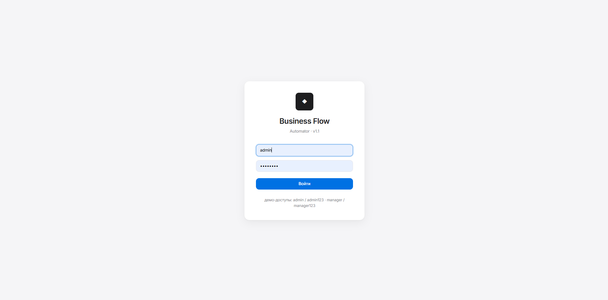
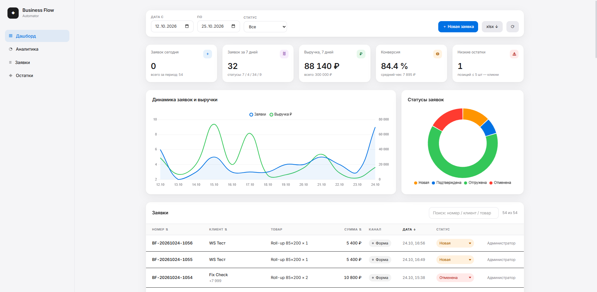
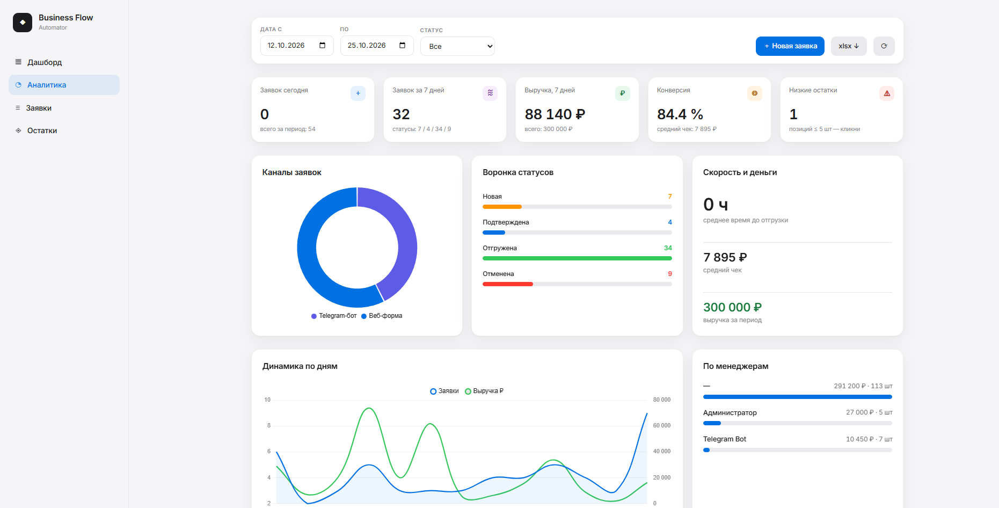
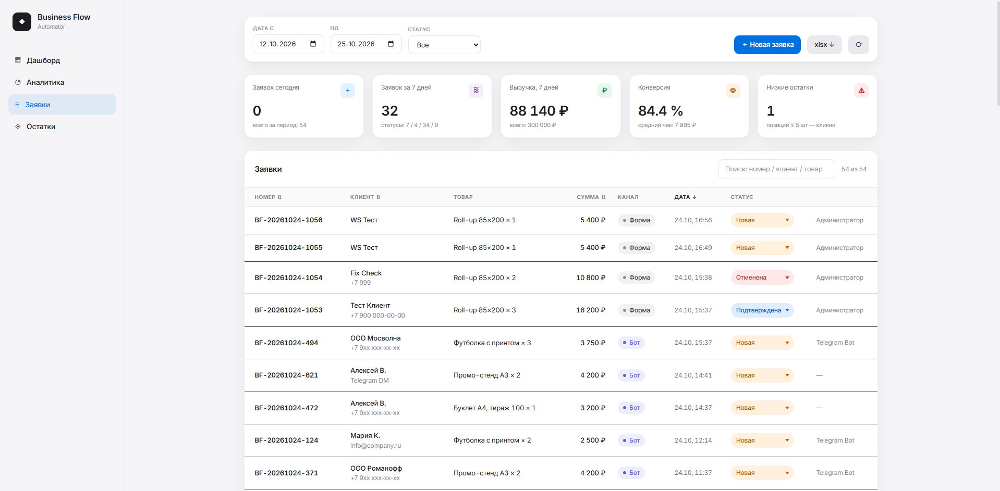
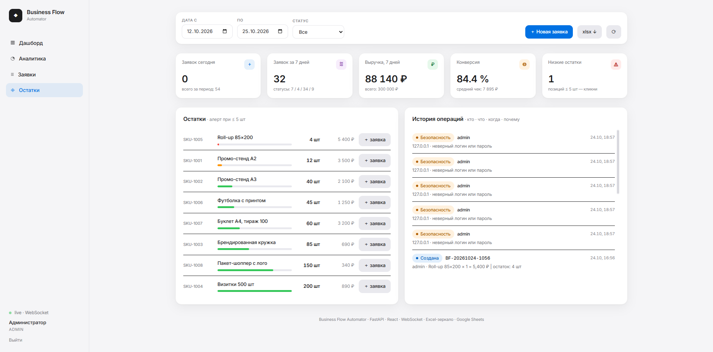

# Business Flow Automator

Внутренняя система автоматизации приёма заявок с контролем остатков, уведомлениями, полной историей изменений и живым дашбордом.

Задача, из которой вырос проект: заявки приходят в Telegram и почту, остатки живут в Google Sheets, «кто отменил и почему» никто не знает, отчёты собираются руками. Это обычная ситуация в среднем бизнесе, и она решается связкой: единая точка приёма заявок + автоматическое списание остатков + неизменяемый журнал действий + дашборд, на который менеджеры смотрят каждый день.

**Стек:** Python 3.12 · FastAPI · SQLAlchemy 2 · PostgreSQL/SQLite · React (Vite + Tailwind 4 + Chart.js) + WebSocket · aiogram 3 · Google Sheets API · APScheduler · Docker

## Как это работает

```
Telegram-бот ───┐                                  ┌── Google Sheets (внешние остатки)
                ├──▶  FastAPI  ──▶  проверка/списание ┘
Веб-форма  ─────┘        │
                         ├──▶ PostgreSQL / SQLite (заявки, журнал операций)
                         ├──▶ Telegram + Email уведомления
                         ├──▶ APScheduler (дневной отчёт, алерты низких остатков)
                         └──▶ WebSocket → дашборд updates в реальном времени
```

Поток заявки: создание (автопросмотр остатка, 409 если не хватает) → подтверждение (автосписание в Sheets и БД, запись в журнал) → отгрузка. Отмена — только с причиной, автоматический возврат остатка. Каждое действие пишется в `operations`: кто, что, когда, почему. Это тот самый вопрос, который обычно разруливается перечитыванием переписки — здесь он закрыт системно.

Статусы можно менять только по допустимым переходам (`new → confirmed/cancelled`, `confirmed → shipped/cancelled`) — защита от «случайно нажал не туда».

## Дашборд

React SPA (Vite, Tailwind 4, Chart.js), авторизация по JWT, роли в бэкенде:

- KPI: заявки за сегодня/неделю, выручка, конверсия, средний чек, низкие остатки
- Графики: динамика заявок/выручки по дням, топ товаров
- Фильтры: даты, статус
- Таблица заявок со сменой статуса в два клика (причина обязательна при отмене)
- Лента журнала операций и панель остатков с индикаторами
- WebSocket: обновления приходят с сервера сами; при недоступности WS падает на поллинг 20 сек
- Адаптив: сайдбар на ПК, таб-навигация на мобилке

Роли: `admin` — всё; `manager` — дашборд и только свои заявки (проверяется на бэкенде, не в UI); `bot` — сервисный доступ для Telegram.

**Рядом лежит `frontend/alpine/index.html`** — та же функциональность одной файлом на Alpine.js. Это осознанный fallback: дашборд работает даже там, где нет Node (старый VPS, срочные правки на проде). FastAPI раздаёт React-сборку, если она собрана, иначе fallback.

## Быстрый старт

Windows: двойной клик `start.bat` — сам создаст venv, поставит зависимости, поднимет сервер и откроет браузер.

```bash
# в ручном режиме
python -m venv .venv
.venv/Scripts/pip install -r backend/requirements.txt   # Windows
.venv/Scripts/python -m uvicorn backend.app.main:app --port 8000
```

Демо-доступы (создаются при первом запуске вместе с демо-данными для графиков):

| Логин | Пароль | Роль |
|---|---|---|
| `admin` | `admin123` | полный доступ |
| `manager` | `manager123` | только свои заявки |

Frontend собирается из `frontend/` (`npm install && npm run build` → `frontend/dist`). Коммитнутая сборка лежит в репозитории, поэтому backend работает из коробки без Node.

Swagger: `/docs`. Healthcheck: `/health`.

## Telegram-бот

`start-bot.bat` поднимет backend (если не запущен) и запустит бота. Нужен `BOT_TOKEN` в `.env` (у @BotFather). Диалог: выбор товара из списка с остатками → количество → имя → контакт → подтверждение. Заявка уходит через тот же REST API, что и веб-форма — отдельная бизнес-логика не дублируется. Уведомления о заявках шлятся в `NOTIFY_CHAT_ID`.

## Остатки: Google Sheets или локально

`GOOGLE_CREDENTIALS_FILE` + `GOOGLE_SHEET_ID` в `.env` — и Sheets становится источником правды: при старте и по `POST /api/inventory/sync` остатки стягиваются в локальное зеркало, каждое списание обновляет колонку C в Sheets.

Формат листа: `SKU | Name | Stock | Price`.

### Подключение Google Sheets за 5 шагов

1. [console.cloud.google.com](https://console.cloud.google.com) → создать проект (бесплатно).
2. APIs & Services → Library → включить **Google Sheets API**.
3. APIs & Services → Credentials → Create credentials → **Service account** → создать JSON-ключ, файл положить в корень проекта как `google-credentials.json` (уже в `.gitignore`).
4. Создать Google-таблицу с листом `Stock`, формат: `SKU | Name | Stock | Price`, и расшарить её на e-mail сервисного аккаунта (адрес в конце JSON, поле `client_email`) с правами Editor.
5. В `.env`: `GOOGLE_CREDENTIALS_FILE=google-credentials.json`, `GOOGLE_SHEET_ID=<id из ссылки таблицы>`. Рестарт — синхронизация подхватится автоматически, статус видно на вкладке «Аналитика → Интеграции».

Без ключей система работает на локальной таблице. Адаптер инвентаря решает ровно одну проблему — Sheets недоступен или не заведён, бизнес-операции не должны падать.

## Excel-зеркало данных

Между API и внешним миром есть третий слой выгрузок — живой Excel (`data/mirror.xlsx`):

- три листа: **Orders** (1000 последних), **Stock**, **Operations** (500 последних записей журнала);
- после каждой операции с заявкой зеркалирование выполняется фоновым таском — Excel никогда не блокирует бизнес-поток;
- скачивается кнопкой **xlsx ↓** в тулбаре дашборда (`GET /api/export/excel`, Bearer-авторизация);
- работает без каких-либо внешних ключей — демо-сценарий «сравнить данные» доступен сразу.

## Расписание

APScheduler внутри backend: ежедневный отчёт в `DAILY_REPORT_HOUR` (заявки, выручка, лидер дня в чат) и проверка остатков каждые `STOCK_CHECK_HOURS` (алерт позиций ≤ `LOW_STOCK_THRESHOLD`). Интервалы — переменные окружения.

## API

| Метод | Путь | Назначение |
|---|---|---|
| POST | `/api/auth/login` | JWT, роль внутри токена |
| GET | `/api/orders` | список с фильтрами; менеджер видит только свои |
| POST | `/api/orders` | создание заявки; проверка остатка, 409 при нехватке |
| PATCH | `/api/orders/{id}/status` | смена статуса + списание/возврат + журнал + уведомления |
| GET | `/api/analytics/metrics` | KPI, серии по дням, топ товаров, каналы, скорость обработки |
| GET | `/api/analytics/operations` | журнал операций |
| GET | `/api/analytics/export/excel` | живое Excel-зеркало (Orders/Stock/Operations) |
| GET | `/api/analytics/integrations` | статус Sheets и Excel-зеркала |
| GET/POST | `/api/inventory` · POST `/api/inventory/sync` | остатки / синхронизация со Sheets |
| WS | `/api/ws` | события заказов для дашборда |

## Запуск через Docker

```bash
cp .env.example .env
docker compose up -d --build            # backend + bot
docker compose --profile full up -d     # + PostgreSQL
```

Deploy: Railway/Render — сервис из `backend/`, второй из `bot/`, `API_PUBLIC_URL` на бот-сервисе указывает на backend. Переменные — из `.env.example`.

## Продуманные компромиссы

- **SQLite по умолчанию** — внутреннему инструменту на 1–5 менеджеров этого достаточно; `DATABASE_URL` меняется на Postgres без правок кода. Alembic миграций нет, `create_all` — честно указано; для прод-развития — первый пункт.
- **Аудит — append-only таблица**, не event sourcing. Для уровня задачи — правильно: историчность важнее переусложнения. Неудачные входы пишутся в тот же журнал (`login_failed` + IP).
- **Пароли — PBKDF2-SHA256 (100k итераций)** без внешних зависимостей (passlib-хелл не оправдан). Перейти на argon2 — при желании.
- **Токен в localStorage, не в httpOnly cookie** — осознанный trade-off: нет CSRF-поверхности, но токен читаем JS при XSS. Прод-эволюция — refresh-token rotation, см. Roadmap. JWT живёт 8 часов; брутфорс входа режется rate-лимитом 5 неудач/мин на IP (429).
- **Внешние сервисы не ломают поток заявки**: Gmail/Sheets/SMTP/Telegram/Excel падение → warning в лог, операция выглядит успешно. Это принципиальное решение — смотри `services/notify.py`, `services/sheets.py`, `services/excel.py`.
- **Бот ходит в REST API backend'а**, а не импортирует Python-код — можно уносить бот в отдельный контейнер/сервер без изменений.
- **Fallback-дашборд на Alpine.js** для bare-metal деплоев без Node.

## Структура

```
backend/app/        main · config · database · models · schemas · security · ws
backend/app/routers/   auth · orders · inventory · analytics
backend/app/services/  sheets · excel · notify · audit · scheduler · seed
frontend/           React (Vite + Tailwind 4 + Chart.js), fallback: alpine/
bot/                aiogram 3, FSM-диалог заказа через REST
docker-compose.yml  backend + bot (+ Postgres по профилю full)
start.bat / stop.bat / start-bot.bat   локальный запуск на Windows одним кликом
```

## Roadmap

Alembic · argon2id · httpOnly refresh-token rotation · Telegram webhook вместо polling · SSE/дробленный WS-канал по вкладкам · 2FA.

## Скриншоты

| | |
|---|---|
|  |  |
|  |  |
|  | |
