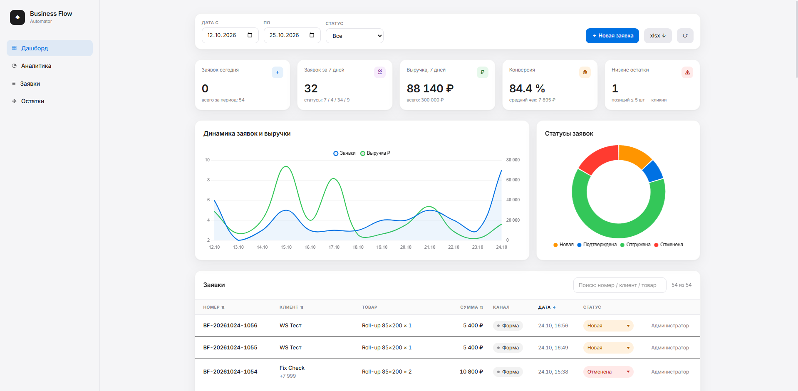
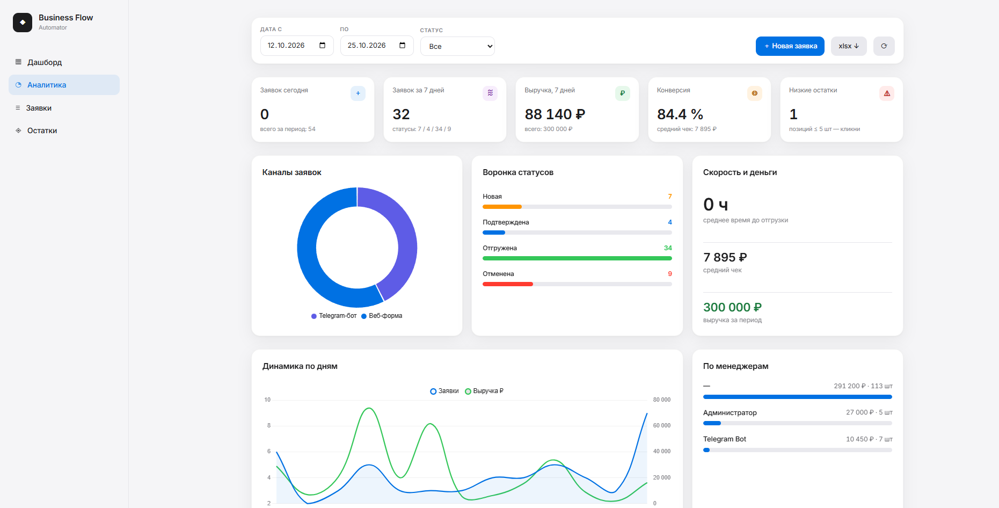
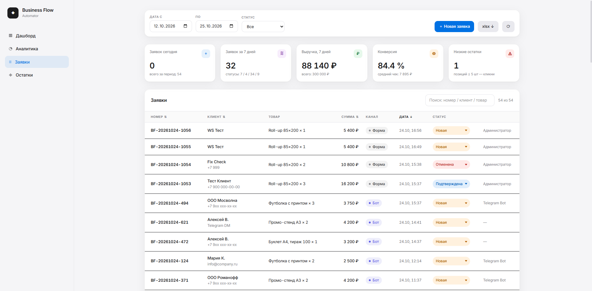
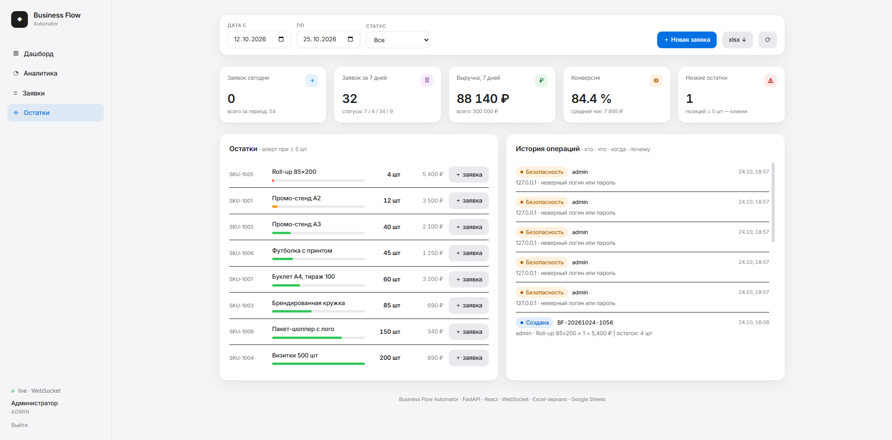

# Business Flow Automator

Внутренняя система заявок и остатков для небольшой торговой компании: заявка
приходит из веб-формы или Telegram, остаток списывается при подтверждении,
каждое действие попадает в журнал, дашборд обновляется по WebSocket.

**Стек:** TypeScript/React 18 · Vite · Tailwind 4 · Chart.js · FastAPI · SQLAlchemy 2.0 ·
PostgreSQL / SQLite · JWT · WebSocket · aiogram 3 · Docker Compose · pytest ·
Node 24 + Hono + Zod (`node-service/`).

## Node/TS mirror

Сразу рядом — [`node-service/`](node-service/): тот же доменный поток на TypeScript + Hono.
Login, orders, confirm, cancel, audit; JWT/RBAC, Zod, идемпотентный confirm, 3 теста.

```bash
cd node-service && npm install && npm test && npm start   # :3100
```

Это не второй backend, а доказательство переноса правил: Python-версия — prod-like контур,
Node-версия — компактный TS-срез под тот же API-контракт.

## Problem → Solution → Result

**Problem.** Заказы теряются в переписках, остатки ведутся в Excel, а после
«кто поменял статус?» приходится перечитывать чат. Типовой сценарий малого
бизнеса: 1–5 менеджеров, один склад, заказы из двух каналов.

**Solution.** Один backend как источник правды:

- заявка создаётся из веб-формы или Telegram-бота через один REST API;
- остаток проверяется при создании и **атомарно списывается** при подтверждении;
- смена статуса ограничена конечным автоматом, отмена требует причину;
- каждое действие пишется в append-only журнал `operations`;
- дашборд получает события после commit, без ручного refresh.

**Result.** Демо поднимается одной командой, сценарий «создать → подтвердить →
отгрузить» проходит без внешних сервисов. Внешние интеграции (Google Sheets,
SMTP, Telegram) опциональны и не ломают основной поток при отказе.

## Architecture

```
HTTP / WebSocket
      │
      ▼
routers/            auth · orders · inventory · analytics
      │             валидация Pydantic, HTTP-коды, RBAC-dependency
      ▼
services/           orders · stock · audit
      │             доменные правила и транзакции
      ▼
models.py           SQLAlchemy 2.0: users, products, orders, operations
      │
      ▼
SQLite / PostgreSQL

services/adapters/  sheets · excel · notify · scheduler
                    вызываются после commit, fail-open
```

| Слой | Ответственность | Файлы |
|---|---|---|
| Router | HTTP, схемы, роли, коды ошибок | `backend/app/routers/` |
| Service | бизнес-правила, транзакция, аудит | `backend/app/services/orders.py`, `stock.py`, `audit.py` |
| Data | ORM-модели и сессия | `backend/app/models.py`, `database.py` |
| Side effects | Sheets/Excel/Telegram/SMTP после commit | `backend/app/services/sheets.py`, `excel.py`, `notify.py` |
| UI | React SPA + WebSocket, fallback на Alpine | `frontend/src/`, `frontend/alpine/` |

Полный путь запроса:

```
Request → JWT auth → Pydantic validation → service → DB transaction
        → commit → WebSocket event / Excel / Telegram / Sheets → clients
```

## AuthZ: роли и проверки на backend

| Роль | Права |
|---|---|
| `admin` | всё: заявки, склад, аналитика, создание товаров |
| `manager` | свои заявки + нераспределённые; смена статусов; чтение склада и аналитики |
| `bot` | только создание заявки и чтение остатков; **не может** менять статусы |

Проверки не дублируются в UI:

- роль берётся из подписанного JWT и сверяется dependency `require(...)`
  (`security.py`);
- доступ к объекту проверяет `services/orders.get_order`: admin — любая заявка,
  manager — своя или нераспределённая (`created_by_id IS NULL`), иначе `403`;
- заявка бота создаётся без владельца — это входящий пул менеджеров, а не
  собственность сервисного аккаунта;
- создание/изменение товара — только `admin`.

Демо упрощено осознанно: один склад и одна организация, поэтому tenant-скоупа
нет. В проде добавился бы `company_id` в токен и в каждый запрос.

## Consistency: списание остатка

Подтверждение заявки — одна транзакция:

```python
# services/orders.change_status
UPDATE orders SET deducted = true WHERE id = :id AND deducted = false
UPDATE products SET stock = stock - :qty WHERE id = :pid AND stock >= :qty
INSERT INTO operations (...)  -- status_confirmed + stock_write_off
COMMIT
```

- `UPDATE ... WHERE stock >= qty` не даёт уйти в минус при параллельных запросах;
- условный `deducted = false` не даёт списать дважды; повторный `confirmed`
  возвращает `200` и ничего не меняет;
- если остаток изменился между созданием и подтверждением — `409 insufficient_stock`
  с актуальным количеством;
- любая ошибка откатывает и статус, и остаток, и аудит: они в одной транзакции;
- отмена подтверждённой заявки возвращает остаток ровно один раз (флаг `deducted`).

Проверки в тестах: `tests/test_api.py::test_confirm_writes_off_once_and_writes_audit`,
`test_cancel_restocks_once_and_requires_reason`, `test_stock_service_never_goes_negative`.

## Audit log

Таблица `operations` — append-only: `ts, actor, action, entity, entity_id, details, reason`.

Пишутся: создание заявки, смена статуса, списание/возврат остатка, неудачный
вход (`login_failed` + IP), действия планировщика. Запись создаётся в той же
транзакции, что и бизнес-изменение, поэтому «статус сменился, а следа нет»
невозможно. Читается через `GET /api/analytics/operations` и вкладку «Журнал».

## Realtime

`POST/PATCH` → commit → `hub.broadcast({"type": "orders_updated", ...})` →
WebSocket-клиенты перезапрашивают данные. Событие отправляется **после** commit,
чтобы клиент не увидел состояние, которого ещё нет в БД. Если WebSocket
недоступен, фронтенд опрашивает API раз в 20 секунд. Токен проверяется при
подключении к `/api/ws`.

## API

| Метод | Путь | Доступ | Назначение |
|---|---|---|---|
| POST | `/api/auth/login` | — | JWT на 8 часов, rate-limit 5 неудач/мин на IP |
| GET | `/api/auth/me` | any | текущий пользователь |
| GET | `/api/orders` | any | фильтры; manager видит свои + нераспределённые |
| POST | `/api/orders` | admin/manager/bot | создание, `409` при нехватке остатка |
| PATCH | `/api/orders/{id}/status` | admin/manager | переход, списание/возврат, аудит |
| GET | `/api/inventory` | any | остатки |
| POST | `/api/inventory` | admin | создание/обновление товара |
| POST | `/api/inventory/sync` | admin | синхронизация с Google Sheets |
| GET | `/api/analytics/metrics` | any | KPI, серии, топ товаров |
| GET | `/api/analytics/operations` | any | журнал операций |
| GET | `/api/analytics/export/excel` | any | Excel-зеркало Orders/Stock/Operations |
| WS | `/api/ws?token=...` | any | события заявок |

Swagger: `/docs`, healthcheck: `/health`.

## Запуск

### Docker (рекомендуется)

```bash
git clone https://github.com/nwl01234/business-flow-automator.git
cd business-flow-automator
cp .env.example .env          # Windows: copy .env.example .env
docker compose up --build
```

Открыть <http://localhost:8000>. Демо-данные и пользователи создаются при
первом старте (`SEED_DEMO=true`).

| Логин | Пароль | Роль |
|---|---|---|
| `admin` | `admin123` | полный доступ |
| `manager` | `manager123` | свои заявки, смена статусов |

Опционально:

```bash
docker compose --profile bot up -d    # Telegram-бот, нужен TELEGRAM_BOT_TOKEN в .env
docker compose --profile full up -d   # PostgreSQL вместо SQLite
```

Dockerfile собирает React-дашборд в multi-stage сборке; `frontend/dist` в
репозиторий не коммитится.

### Локально без Docker

```bash
python -m venv .venv
.venv/Scripts/pip install -r backend/requirements.txt   # Windows
.venv/Scripts/python -m uvicorn backend.app.main:app --port 8000
```

Без собранного `frontend/dist` backend отдаёт `frontend/alpine/index.html` —
тот же сценарий без Node. Для React-версии: `cd frontend && npm ci && npm run build`.

Windows-альтернатива: `start.bat` создаёт venv, ставит зависимости и открывает браузер.

## Тесты и CI

```bash
pip install -r backend/requirements.txt pytest
pytest -q tests
```

12 тестов: отсутствие/битый токен, RBAC на складе, валидация заявки,
`409` при нехватке, однократное списание, идемпотентный повтор, возврат при
отмене, обязательная причина отмены, недопустимый переход, object-level доступ
менеджера, нераспределённые заявки бота, атомарность склада и идемпотентный seed.

Плюс `node-service`: 3 теста на confirm/идемпотентность, RBAC и 400/409.

CI (`.github/workflows/ci.yml`): pytest + сборка React + typecheck и тесты
Node-среза на каждый push/PR.

## Design decisions

- **SQLite по умолчанию, PostgreSQL по `DATABASE_URL`.** Для 1–5 менеджеров
  SQLite достаточно, а демо не требует инфраструктуры. Ограничение честное:
  Alembic-миграций нет, схема создаётся `create_all`; для прод-развития это
  первый пункт roadmap.
- **Остаток списывается при подтверждении, а не при создании.** Заявка — это
  ещё не продажа; резервирование усложнило бы модель (TTL, снятие резерва).
  Между созданием и подтверждением возможен oversell — его режет атомарный
  `UPDATE ... WHERE stock >= qty` на подтверждении.
- **Аудит — таблица, не event sourcing.** Достаточно для вопроса «кто и когда»,
  без инфраструктуры брокера и проекций.
- **Побочные эффекты после commit и fail-open.** Упавший Telegram/Sheets/SMTP
  пишет warning, но не отменяет заявку. Иначе внешний сервис становится
  точкой отказа основного бизнес-процесса.
- **JWT в localStorage.** Нет CSRF-поверхности, но токен доступен при XSS.
  Прод-эволюция — httpOnly refresh-cookie с rotation. Сейчас TTL 8 часов.
- **Бот ходит в REST API, а не импортирует код.** Его можно вынести в отдельный
  контейнер/сервер без изменения бизнес-логики.
- **Alpine-fallback.** Для VPS без Node остаётся рабочий дашборд; React-сборка —
  основной вариант.

## Что дальше

Alembic · argon2id · refresh-token rotation · tenant/`company_id` · резервирование
остатка с TTL · pagination в списке заявок · structured logging + request-id.

## Скриншоты

| Дашборд | Заявки |
|---|---|
|  |  |

| Склад | Журнал |
|---|---|
|  |  |
